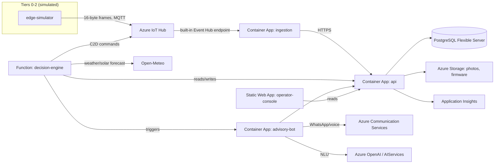

# DHARA Platform Architecture

This is the as-built architecture for the software implementation of the DHARA
design (`DHARA — Sustainable Agriculture Platform.pdf`), mapped onto Azure. It follows
the source document's five-tier structure; Tiers 0-2 (physical hardware) are stood in
for by a software simulator so the full Tier-3 cloud loop can be built, deployed, and
demonstrated without manufacturing anything.

## Tier mapping

| Tier (from the design doc) | What it is | This implementation |
|---|---|---|
| 0 — Field | Soil probes, flow meter, energy meter, valves | Simulated in `services/edge-simulator` |
| 1 — Farm edge | ESP32 controller, local water-balance loop, degradation ladder | Simulated (moisture/flow physics) + real logic ported to `packages/dhara_shared` so the *same* water-balance code the cloud runs is what a real edge box would run offline |
| 2 — Village cluster | LoRaWAN gateway, solar arbitration, cached models | Represented as a `gateway` Device row; real gateway hardware would terminate LoRaWAN and forward over the same 16-byte frame to IoT Hub |
| 3 — Cloud | Decision engine, energy optimiser, verification ledger | **Fully implemented**, running on Azure (this is the real deliverable) |
| 4 — People | Pump-box lamps, voice call, WhatsApp, operator console | **Fully implemented** for voice + WhatsApp + console; lamps are a hardware GPIO output driven by the same C2D command the edge box already receives |

## Azure service map

## Core data model

Seven entities carry the full audit trail (`packages/dhara_shared/dhara_shared/models.py`):

- **Plot** — one farmer's field: geometry, soil parameters, seasonal volumetric cap
- **CropCycle** — crop, variety, sowing date, growth stage, Kc curve
- **Device** — physical identity (IoT Hub deviceId), health, degradation level
- **Reading** — one sensor value at one timestamp
- **Decision** — the control loop's output: depth, reason code, input hash, model version
- **IrrigationEvent** — what actually happened, verified against the flow meter
- **StorageLot** — one cold-room batch, thermal history, predicted shelf life

`Decision` and `IrrigationEvent` are the audit pair the design calls for: every litre
moved is traceable to the reasoning that asked for it, via `input_hash` (SHA-256 of
the sensed+forecast inputs) and `reason_code`.

Two more tables exist purely for the cloud platform's own operation, not in the
original seven: `EnergyArbitrationLog` (one row per cluster per control-loop tick) and
`AdvisoryInteraction` (every WhatsApp/voice/lamp exchange) and `SavingsLedgerEntry`
(the weekly auditable savings claim).

## The control loop, as code

`services/decision-engine/logic.py` implements the same five-step loop the design
specifies, running every 15 minutes (`CONTROL_LOOP_INTERVAL_MINUTES`):

1. **Sense** — pull the last hour of readings for the plot's devices from the API
2. **Estimate** — `dhara_shared.water_balance.compute_water_balance()`: FAO-56 root-zone
   balance, corrected by the measured probe reading
3. **Decide** — refill threshold crossed? capped at the plot's remaining seasonal
   volumetric allocation? → a `Decision` row
4. **Actuate** — a cloud-to-device message via IoT Hub (`send_c2d_message`) carrying
   the depth/volume to apply
5. **Verify** — a second timer (`verify_irrigation_events`) reconciles the flow
   meter's *measured* cumulative counter against the *intended* volume once the
   window closes, and only then counts it against the plot's seasonal allocation

The energy optimiser (`dhara_shared.energy_optimizer.arbitrate`) enforces the fixed
six-step priority order from the design (crop-critical irrigation → cold-room
pulldown → tank fill, capped → thermal store → battery → grid export) every cycle,
logged per cluster.

The degradation ladder (`dhara_shared.degradation`) is implemented as a pure function
(`classify_rung`) so the cloud decision engine and a real edge box's local firmware
can agree on L0-L4 state from the same inputs — the cloud never needs to be trusted as
the sole authority on what mode a plot is in.

## Farmer interface (Tier 4)

| Rung | Channel | Where |
|---|---|---|
| 1 | Pump-box lamps | GPIO on real hardware, driven by the same C2D `irrigate`/`stop` command the edge box already receives — no separate integration needed |
| 2 | Outbound voice call | `services/advisory-bot/app/voice.py`, Azure Communication Services Call Automation. Triggered daily at 06:40 by the decision-engine's `DailyVoiceAdvisory` timer |
| 3 | WhatsApp | `services/advisory-bot/app/whatsapp.py`, ACS Advanced Messaging + Azure OpenAI, confidence-gated |
| 4 | Operator console | `apps/operator-console`, React SPA on Static Web Apps |

Confidence gating (`services/advisory-bot/app/confidence_gate.py`) is enforced, not
advisory: below `ADVISORY_CONFIDENCE_THRESHOLD` (default 0.72), the bot says it does
not know and marks the interaction `escalated_to_human`, visible on the console's
Advisory Log page.

## Known hardening items (pilot → production)

Being direct about what a pilot-scoped build leaves for later, in priority order:

1. **Operator console has no sign-in yet.** The Entra ID app registration and API
   scope are provisioned (`docs/azure-requirements.md` §8) and
   `dhara_shared.auth.validate_entra_token()` is implemented, but the console
   currently calls the API's `GET` routes unauthenticated, and those routes have no
   `require_service_key`/token dependency. Before this holds real farmer phone
   numbers and locations on the open internet: wire `@azure/msal-react` into the
   console and add an Entra-token dependency to every `GET` route.
2. **WhatsApp and voice need Meta/telecom approvals that can't be automated**
   (business verification, a purchased phone number) — see
   `docs/azure-requirements.md` §5. The code path is complete and testable by posting
   synthetic Event Grid payloads in the meantime.
3. **CORS is wide open** (`allow_origins=["*"]` in `services/api/app/main.py`) for
   pilot convenience. Restrict to the Static Web App's origin once that URL is
   stable.
4. **No API Management / rate limiting** in front of the Container Apps. Fine for a
   100-1,000-farm pilot; add APIM or Front Door before a public discom/carbon-market
   integration.
5. **Single-region.** No geo-redundancy on Postgres or storage. Add
   `geoRedundantBackup` and read replicas when moving past Phase 1.
6. **Function App settings hold secrets as plain app settings**, not Key Vault
   references. Container Apps' secrets are at least a distinct, access-controlled
   object; `decision-engine`'s `IOT_HUB_CONNECTION_STRING` etc. are plain
   `Microsoft.Web/sites` app settings. Migrate to
   `@Microsoft.KeyVault(SecretUri=...)` references before this holds production
   credentials for long.
7. **`ingestion`'s Event Hub consumer has no checkpoint store.** It starts from
   `@latest` on every restart, so a crash or redeploy loses whatever arrived while
   it was down (no reprocessing, no double-processing — just a gap). Fine for a
   live-telemetry pilot; add a `BlobCheckpointStore` (the storage account already
   exists) before this needs to survive restarts without gaps.

## Why these specific Azure choices

- **Container Apps over App Service** for `api`/`advisory-bot`: scale-to-zero on the
  advisory-bot (bursty, event-driven), simple container deploy, no separate App
  Service Plan to size.
- **Azure Functions (Flex Consumption) for `decision-engine`**: fundamentally
  timer-driven, near-zero idle cost between 15-minute ticks. `ingestion` was
  originally the same shape (an Event Hub trigger), but its trigger never fired a
  single execution across four different hosting configurations in this
  deployment — see `docs/SETUP.md`'s "war story" for the full diagnostic trail and
  the actual root cause (an IoT Hub routing bug, not a Functions problem at all).
  It now runs as a plain Container App against the `azure-eventhub` SDK directly
  (`services/ingestion/consumer.py`) — simpler to operate and with no
  Functions-specific scale-controller behaviour to reason about.
- **PostgreSQL Flexible Server, not Cosmos DB**: the data is fundamentally relational
  (seven entities with real foreign keys, and the audit trail depends on join
  integrity between Decision/IrrigationEvent). JSON columns (`kc_curve`,
  `thermal_history`, `allocations`) cover the few genuinely schema-flexible fields.
- **One Postgres table for `Reading`, not a separate time-series database**: at pilot
  scale (100-1,000 farms × ~6 metrics × every 15 min) this is a few million rows a
  season — well within Postgres. Revisit only past Phase 2 (100 clusters).
